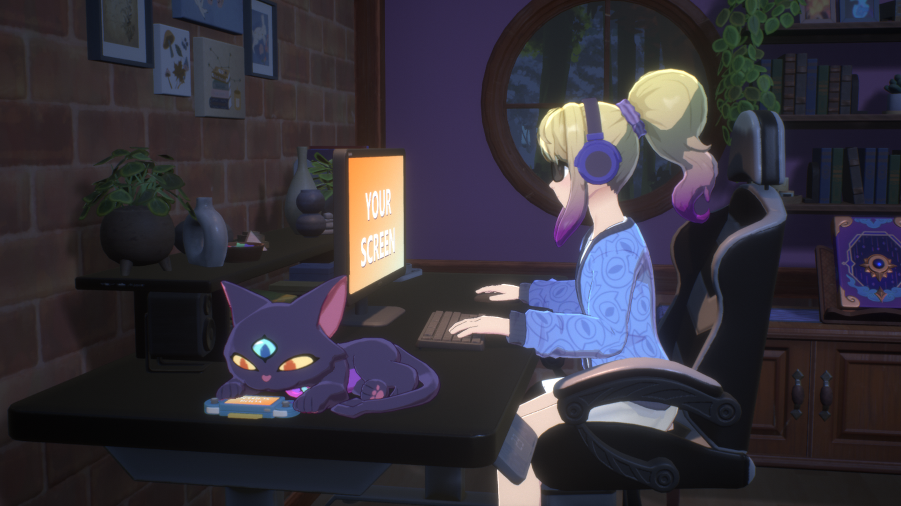
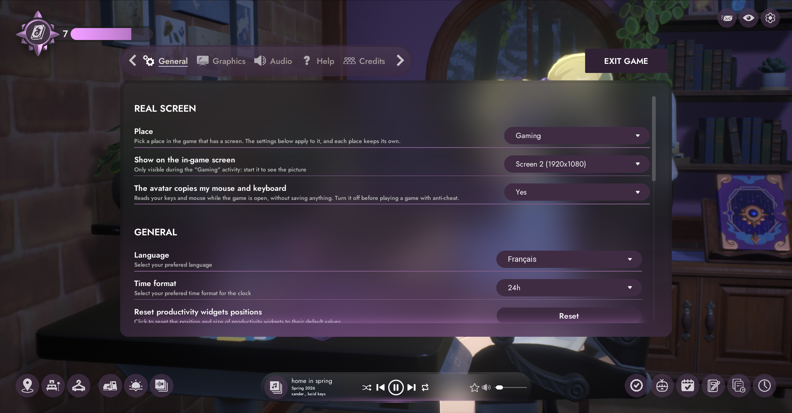

# Real Screen

A mod for Spirit City: Lofi Sessions: your real screen inside the game. Un mod pour Spirit City: Lofi Sessions : votre vrai écran dans le jeu.

**[Download / Télécharger](https://github.com/Demonwal51/RealScreen/releases/latest)** · **[Nexus Mods](https://www.nexusmods.com/spiritcitylofisessions/mods/19)**

The in-game screens show what you choose instead of their usual picture. You pick the place, and each place keeps its own choice:

- Gaming: the desk monitor and the handheld consoles
- Typing and Browsing: the laptop (in the game's activity list, Browsing is under Bed)
- Drawing: the drawing tablet

Each place can show:

- One of your monitors, live: your real game on the avatar's screen
- One application: a browser, Spotify, Discord...
- A video file on a loop, with its sound if you want it
- Off: the game's original picture stays

Out of the box, Gaming shows your first monitor and the other places are off.

Everything is set up inside the game: Options, General, REAL SCREEN. The menu opens on the place you are in. It uses the game's own rows and dropdowns, and follows your UI theme.

The menu follows the game's language: English, French, Italian, German, Spanish, Portuguese, Japanese, Simplified Chinese, Korean and Russian. The translations were written by an AI, so corrections are welcome.

Optional: the avatar copies you. During Gaming at the desk, one hand follows your mouse and a finger presses the key you press. During Typing, in every spot of every map, both hands type on the laptop along with your keyboard: each key you press lowers the matching finger. The mouse is not copied during Typing. When you do not touch anything, the hands do not move.

## Install

1. Unzip the archive anywhere.
2. Double-click Install.bat. It finds the game by itself. If the game is open, it asks you to close it and carries on once it is closed.
3. Start the game and choose Gaming at the desk: your first monitor is on the avatar's screen.

To change anything: Options, General, REAL SCREEN. The picture only shows during the activity, and the game does not go back to it by itself when it starts.

To remove it: double-click Uninstall.bat.
UE4SS is included. If you already use UE4SS, yours is kept.

## What the .bat files do

Install.bat and Uninstall.bat first check that the archive is unzipped. Then each one starts a single PowerShell script, `files\setup.ps1`, and allows scripts for that run only (-ExecutionPolicy Bypass). You can open all three with Notepad and read them before running anything.

Install.bat:
- Finds the game: it reads the Steam location from the registry, then your Steam libraries. If it does not find the game, it asks you for the folder.
- Refuses and changes nothing if the folder is not the game's.
- If the game is open, it waits until you close it.
- Copies dwmapi.dll and the ue4ss folder into `SpiritCity\Binaries\Win64`, in the game folder, with a small text file that records that this mod installed UE4SS.
- If UE4SS is already installed, it copies only the mod's folder and adds the mod to UE4SS's mods.txt.
- Keeps your settings if you install again.

Uninstall.bat:
- Finds the game the same way, and waits until you close it if it is open.
- Removes the mod's folder.
- Removes UE4SS, dwmapi.dll and the empty LogicMods folder too if this mod installed UE4SS and no other UE4SS mod is there. Otherwise it leaves UE4SS in place, and if UE4SS was there before this mod, it takes the mod out of mods.txt.

Neither of them downloads anything, asks for administrator rights, writes to the registry, adds anything to Windows startup or changes your antivirus settings. They do not touch the game's own files or your saves. The logs that UE4SS and the mod create while running are removed with their folders.

Prefer not to run them? Copy the content of `files\game` into the game folder yourself. To remove it, delete dwmapi.dll and the ue4ss folder from `SpiritCity\Binaries\Win64`.

## Good to know

- Put the game on a second monitor to watch your main one. If the game films its own monitor, you get an endless mirror: harmless.
- A minimized window shows nothing, and some protected windows may stay black.
- Video: any format Windows can read. mp4 is the safest.
- The video's sound has its own line in the Windows volume mixer, separate from the game's.

## Privacy and safety: please read

The mouse and keyboard copy is off by default. When you switch it on, a small hidden program (ecran_entrees.exe) reads your keys and mouse while the game is open, even when you are in another application. It keeps only the present state, writes nothing and sends nothing, and it closes with the game. Antivirus programs may distrust it. Its source code is on GitHub: https://github.com/Demonwal51/RealScreen

Anti-cheat: the mod loads code into Spirit City only and touches no other game, but it has not been checked against anti-cheat systems. To be safe, close Spirit City, or at least switch this option off, before playing a game with an anti-cheat. Use it at your own risk.

## Requirements

Windows 10 (version 1903 or later) or Windows 11.
Spirit City: Lofi Sessions on Steam, tested on game build CL-1381 (Unreal Engine 5.7.3).
A game update can break the mod: if the game stops starting, run Uninstall.bat. Your save is not touched.

## Troubleshooting

The logs are in `SpiritCity\Binaries\Win64\ue4ss`: UE4SS.log, then `Mods\EcranReel\journal.txt` and capture.log.

## Credits

Included in the archive:
- UE4SS (https://github.com/UE4SS-RE/RE-UE4SS), MIT licence: it loads the mod into the game.

Used to make the mod:
- Claude Code by Anthropic (https://claude.com/claude-code), an AI coding assistant: it wrote the code, the tests and these texts.
- Universal Modder by rehan-remade (https://github.com/rehan-remade/universal-modder): modding guides and the pre-release check.
- repak by trumank (https://github.com/trumank/repak): to read the game's text tables.
- Microsoft Visual Studio and C++/WinRT: to build the programs.
- Python, Pillow, pycaw, FFmpeg, PowerShell and Git: for the tests and the images.

The pictures of the game come from Spirit City: Lofi Sessions by Mooncube Games. This mod is not affiliated with Mooncube Games.
Made by Demonwal51. Licence of this mod: MIT.

## Code

- `mods/EcranReel/Scripts/main.lua`: the mod itself (UE4SS Lua): finds the screens, the menu, the hands.
- `capture/ecran_capture.cpp`: the capture DLL (monitor, application, video), on its own thread and its own D3D11 device.
- `capture/ecran_entrees.cpp`: the small program that reads the keyboard and the mouse.
- `capture/construire.py`: builds both with Visual Studio.
- `install/`: what the `.bat` files run.

The commands in `main.lua` that only answer when a `dev.txt` file sits next to the mod are its test bridge. The released archive has no `dev.txt`.

---

# Français

Les écrans du jeu montrent ce que vous choisissez à la place de leur image habituelle. Vous choisissez l'endroit, et chaque endroit garde son propre choix :

- Jouer : le moniteur du bureau et les consoles portables
- Clavarder et Naviguer : l'ordinateur portable (dans la liste des activités du jeu, Naviguer se trouve sous Lit)
- Dessiner : la tablette graphique

Chaque endroit peut montrer :

- Un de vos écrans, en direct : votre vrai jeu sur l'écran de l'avatar
- Une application : un navigateur, Spotify, Discord...
- Un fichier vidéo en boucle, avec son son si vous le souhaitez
- Désactivé : l'image d'origine du jeu reste

Au départ, Jouer montre votre premier écran et les autres endroits sont désactivés.

Tout se règle dans le jeu : Options, Général, ÉCRAN RÉEL. Le menu s'ouvre sur l'endroit où vous êtes. Il utilise les lignes et les listes déroulantes du jeu, et suit votre thème d'interface.

Le menu suit la langue du jeu : anglais, français, italien, allemand, espagnol, portugais, japonais, chinois simplifié, coréen et russe. Les traductions ont été écrites par une IA, les corrections sont donc les bienvenues.

En option : l'avatar vous copie. Pendant Jouer au bureau, une main suit votre souris et un doigt appuie sur la touche que vous pressez. Pendant Clavarder, à chaque endroit de chaque carte, les deux mains tapent sur le portable en même temps que votre clavier : chaque touche pressée baisse le doigt correspondant. La souris n'est pas copiée pendant Clavarder. Quand vous ne touchez à rien, les mains ne bougent pas.

## Installer

1. Dézippez l'archive, où vous voulez.
2. Double-cliquez sur Install.bat. Il trouve le jeu tout seul. Si le jeu est ouvert, il vous demande de le fermer et continue une fois le jeu fermé.
3. Lancez le jeu et choisissez Jouer au bureau : votre premier écran est sur l'écran de l'avatar.

Pour changer quoi que ce soit : Options, Général, ÉCRAN RÉEL. L'image n'apparaît que pendant l'activité, et le jeu n'y revient pas tout seul au démarrage.

Pour le retirer : double-cliquez sur Uninstall.bat.
UE4SS est inclus. Si vous utilisez déjà UE4SS, le vôtre est conservé.

## Ce que font les fichiers .bat

Install.bat et Uninstall.bat vérifient d'abord que l'archive est dézippée. Ensuite, chacun lance un seul script PowerShell, `files\setup.ps1`, et autorise les scripts pour cette exécution seulement (-ExecutionPolicy Bypass). Vous pouvez ouvrir les trois avec le Bloc-notes et les lire avant de lancer quoi que ce soit.

Install.bat :
- Trouve le jeu : il lit l'emplacement de Steam dans le registre, puis vos bibliothèques Steam. S'il ne trouve pas le jeu, il vous demande le dossier.
- Refuse et ne change rien si le dossier n'est pas celui du jeu.
- Si le jeu est ouvert, il attend que vous le fermiez.
- Copie dwmapi.dll et le dossier ue4ss dans `SpiritCity\Binaries\Win64`, dans le dossier du jeu, avec un petit fichier texte qui note que ce mod a installé UE4SS.
- Si UE4SS est déjà installé, il copie seulement le dossier du mod et ajoute le mod au fichier mods.txt d'UE4SS.
- Garde vos réglages si vous réinstallez.

Uninstall.bat :
- Trouve le jeu de la même façon, et attend que vous le fermiez s'il est ouvert.
- Retire le dossier du mod.
- Retire aussi UE4SS, dwmapi.dll et le dossier LogicMods vide si ce mod a installé UE4SS et qu'aucun autre mod UE4SS n'est présent. Sinon il laisse UE4SS en place, et si UE4SS était là avant ce mod, il retire le mod de mods.txt.

Aucun des deux ne télécharge quoi que ce soit, ne demande les droits d'administrateur, n'écrit dans le registre, n'ajoute quoi que ce soit au démarrage de Windows et ne change les réglages de votre antivirus. Ils ne touchent ni aux fichiers du jeu ni à vos sauvegardes. Les journaux créés par UE4SS et le mod pendant leur fonctionnement sont retirés avec leurs dossiers.

Vous préférez ne pas les lancer ? Copiez vous-même le contenu de `files\game` dans le dossier du jeu. Pour le retirer, effacez dwmapi.dll et le dossier ue4ss de `SpiritCity\Binaries\Win64`.

## Bon à savoir

- Mettez le jeu sur un deuxième écran pour regarder votre écran principal. Si le jeu filme son propre écran, vous obtenez un miroir sans fin : c'est sans danger.
- Une fenêtre réduite n'affiche rien, et certaines fenêtres protégées peuvent rester noires.
- Vidéo : tout format que Windows sait lire. Le mp4 est le plus sûr.
- Le son de la vidéo a sa propre ligne dans le mélangeur de volume de Windows, à part de celle du jeu.

## Vie privée et sécurité : à lire

La copie de la souris et du clavier est coupée par défaut. Quand vous l'activez, un petit programme caché (ecran_entrees.exe) lit vos touches et votre souris tant que le jeu est ouvert, même quand vous êtes dans une autre application. Il ne garde que l'état présent, n'écrit rien et n'envoie rien, et il se ferme avec le jeu. Un antivirus peut s'en méfier. Son code source est sur GitHub : https://github.com/Demonwal51/RealScreen

Anti-triche : le mod charge du code dans Spirit City seulement et ne touche à aucun autre jeu, mais il n'a pas été vérifié face aux systèmes anti-triche. Par prudence, fermez Spirit City, ou au moins coupez cette option, avant de jouer à un jeu avec un anti-triche. Utilisation à vos risques.

## Configuration requise

Windows 10 (version 1903 ou plus récente) ou Windows 11.
Spirit City: Lofi Sessions sur Steam, testé sur la version CL-1381 du jeu (Unreal Engine 5.7.3).
Une mise à jour du jeu peut casser le mod : si le jeu ne démarre plus, lancez Uninstall.bat. Votre sauvegarde n'est pas touchée.

## En cas de problème

Les journaux sont dans `SpiritCity\Binaries\Win64\ue4ss` : UE4SS.log, puis `Mods\EcranReel\journal.txt` et capture.log.

## Crédits

Inclus dans l'archive :
- UE4SS (https://github.com/UE4SS-RE/RE-UE4SS), licence MIT : il charge le mod dans le jeu.

Utilisés pour faire le mod :
- Claude Code d'Anthropic (https://claude.com/claude-code), un assistant de programmation par IA : il a écrit le code, les essais et ces textes.
- Universal Modder de rehan-remade (https://github.com/rehan-remade/universal-modder) : guides de modding et contrôle avant publication.
- repak de trumank (https://github.com/trumank/repak) : pour lire les tables de textes du jeu.
- Microsoft Visual Studio et C++/WinRT : pour compiler les programmes.
- Python, Pillow, pycaw, FFmpeg, PowerShell et Git : pour les essais et les images.

Les images du jeu viennent de Spirit City: Lofi Sessions de Mooncube Games. Ce mod n'est pas affilié à Mooncube Games.
Fait par Demonwal51. Licence de ce mod : MIT.

## Code

- `mods/EcranReel/Scripts/main.lua` : le mod lui-même (Lua d'UE4SS) : trouve les écrans, le menu, les mains.
- `capture/ecran_capture.cpp` : la DLL de capture (écran, application, vidéo), sur son propre fil et son propre périphérique D3D11.
- `capture/ecran_entrees.cpp` : le petit programme qui lit le clavier et la souris.
- `capture/construire.py` : compile les deux avec Visual Studio.
- `install/` : ce que lancent les fichiers `.bat`.

Les commandes de `main.lua` qui ne répondent que si un fichier `dev.txt` est à côté du mod servent aux essais. L'archive publiée n'a pas de `dev.txt`.
